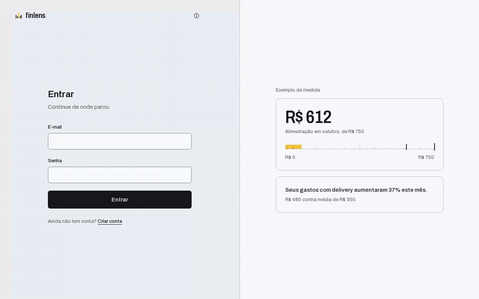
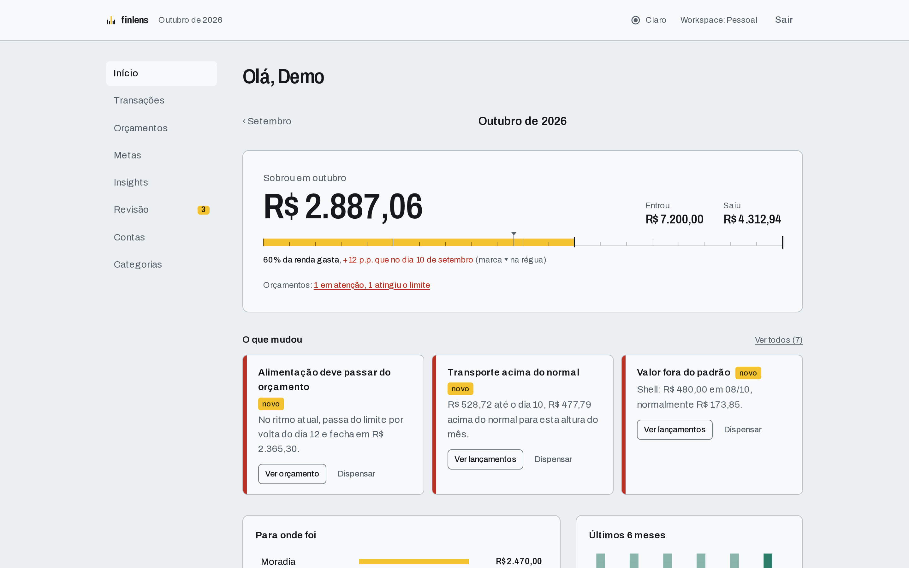
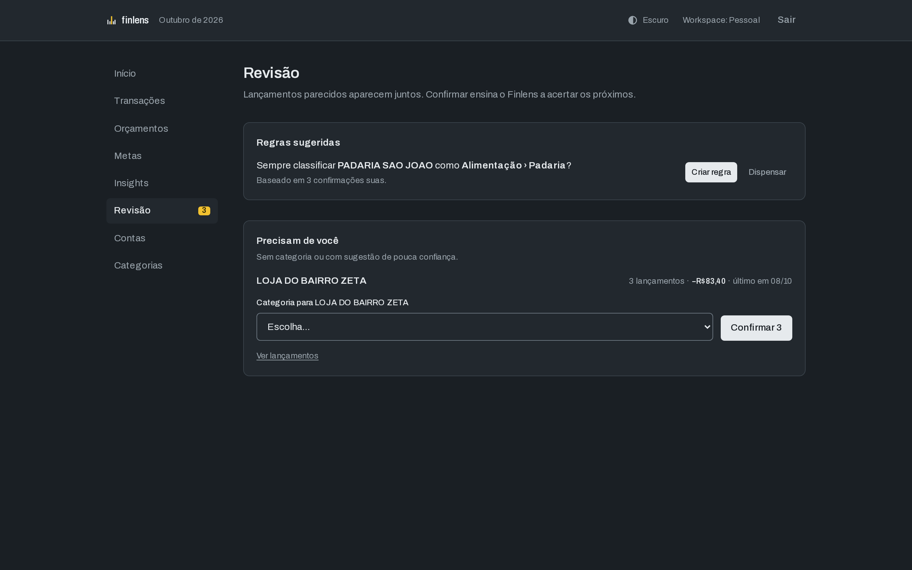
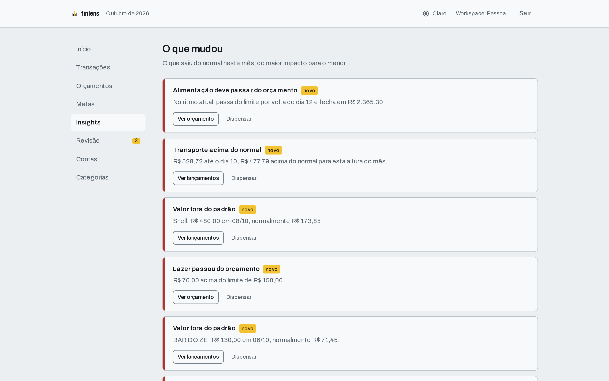
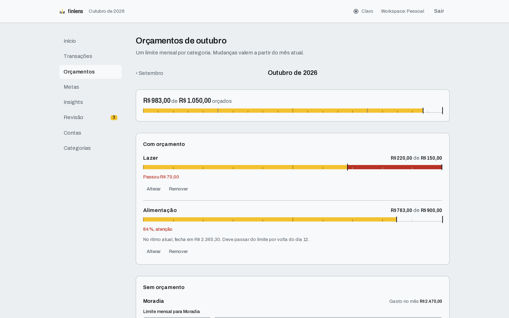
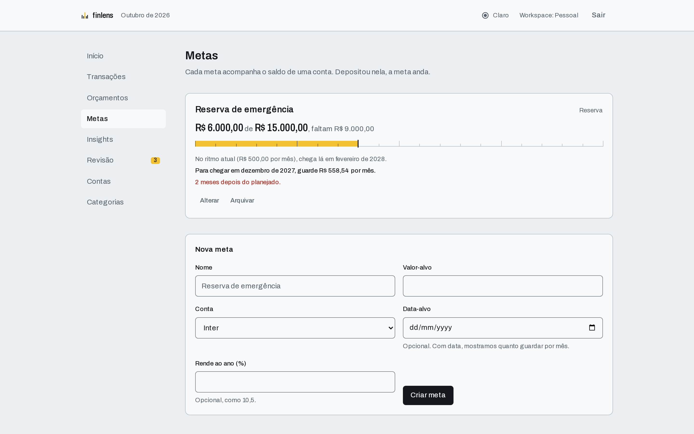
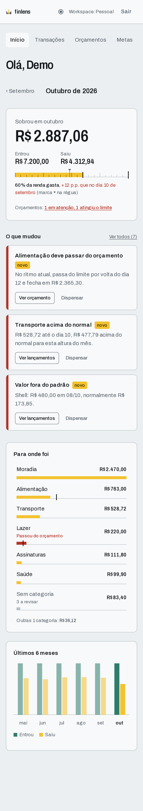

# Finlens

[](https://github.com/Momas7/finlens/actions/workflows/ci.yml)
[](LICENSE)

Analista financeiro pessoal, open source e self-hosted. Ele classifica seus lançamentos sozinho, pede confirmação só do que tem dúvida e aprende com cada correção. Também mostra o que saiu do normal no mês, com números e uma ação.



Não é um CRUD de despesas. O núcleo é um classificador em camadas, medido no CI (regras, histórico do usuário, similaridade, dicionário de estabelecimentos), e um motor de insights determinístico que nunca inventa números.

## Experimente em 1 comando

Precisa só de Docker ou Podman com Compose:

```bash
git clone https://github.com/Momas7/finlens && cd finlens
docker compose --profile demo up --build      # ou: podman compose --profile demo up --build
```

Abra http://localhost:3000 e entre com **demo@finlens.local** / **demo-finlens-123**.

A conta demo tem seis meses de dados fictícios, com casos plantados para cada tela: uma cobrança duplicada, um valor fora do padrão, um orçamento estourado, lançamentos esperando revisão, uma regra sugerida, uma assinatura nova (Spotify), um aumento de preço (Netflix) e dois parcelamentos (Magalu e notebook). Ela é criada pela própria API, então classificação e aprendizado rodam de verdade.

> Senhas e segredo do perfil `demo` são **apenas para uso local**. Não exponha esse perfil na internet.

## O que ele faz

### Painel do mês

Quanto sobrou e qual fatia da renda já foi gasta, comparada com o mesmo dia do mês passado (a marca ▾ na régua). Também mostra para onde foi o dinheiro e os últimos 6 meses. Os gráficos são SVG renderizados no servidor, sem JavaScript no cliente, e cada um tem uma tabela equivalente para leitor de tela.



### Classificação que aprende e revisão em lote

Cada lançamento é classificado ao ser salvo, com a confiança e o motivo. O que tem dúvida vai para a Revisão, agrupado por estabelecimento: um clique confirma o grupo inteiro. Corrigir um lançamento oferece levar a correção para os parecidos. Depois de três confirmações iguais, o Finlens propõe uma regra.



### Importação de extratos

Envie o arquivo do banco e veja a prévia antes de gravar: quantos lançamentos são novos, quantos já foram importados e quais já existem porque você lançou à mão. A fatura do cartão Inter (CSV) é reconhecida direto, o OFX é lido pelo padrão, e um CSV de outro banco pede só que você aponte as colunas de data, descrição e valor. Reimportar um período que se sobrepõe ao anterior traz apenas o que é novo. O que entra passa pela classificação normal e cai na Revisão.

### Transferências

Quando duas pontas têm valores iguais e opostos em contas diferentes (uma transferência para a poupança, o pagamento da fatura do cartão), o Finlens liga as duas e as tira de gastos e receitas. Liga sozinho só o óbvio (PIX, TED, fatura ou o nome da outra conta no texto, até 1 dia, sem ambiguidade); o resto vira sugestão na Revisão.

### Recorrências

O histórico de saídas revela o que se repete (assinaturas, aluguel, planos): cadência, valor típico, próxima cobrança e custo mensal equivalente. A tela mostra o total por mês e três avisos entram nos insights: cobrança que não veio, aumento de preço e assinatura nova. Tudo é calculado na hora, sem cadastro.

### Parcelas

Compras parceladas (`PARC 03/10` no texto) viram planos: parcela atual, quantas faltam, quanto sobra a pagar e o compromisso de cada mês. Dois avisos entram nos insights: quando as parcelas do mês seguinte passam de 30% da renda e quando um parcelamento está terminando.

### IA local opcional

Desligada por padrão. Com um servidor compatível com `/chat/completions` da OpenAI (Ollama, llama.cpp, LM Studio), a Revisão ganha o botão "Sugerir com IA" nos grupos que nenhuma camada do classificador reconheceu. Ela só roda quando você clica, preenche o seletor com a categoria sugerida (confiança limitada a 80%) e não grava nada até você confirmar.

```bash
# .env
LLM_BASE_URL=http://localhost:11434/v1
LLM_MODEL=qwen2.5:3b
LLM_API_KEY=            # opcional
```

> **Privacidade:** saem apenas a descrição normalizada (sem números longos, cidade, datas nem a contraparte de PIX), o sentido (saída ou entrada) e os nomes das categorias. Valor, data, conta e ids nunca saem. Com um servidor remoto, esse texto sai da sua máquina; prefira um modelo local.

### Insights

Doze geradores puros olham o mês corrente (os de recorrência olham o histórico de até 26 meses):

- categoria acima do normal até o mesmo dia do mês;
- pequenas compras que se somam;
- valor fora do padrão (z-score robusto com mediana e MAD);
- tarifas, juros e IOF;
- possível cobrança duplicada;
- orçamento estourando;
- queda na taxa de poupança;
- cobrança recorrente que não veio, aumento de preço e assinatura nova;
- compromisso alto de parcelas e parcelamento terminando.

Cada insight traz o impacto em reais e uma ação. Dispensado, não volta.



### Orçamentos

Um limite mensal por categoria, versionado por mês: mudar o limite em outubro não reescreve setembro. A tela mostra o estado (atenção a partir de 80%), o ritmo ("No ritmo atual, fecha em R$ X") e uma sugestão de limite pela mediana dos meses anteriores.



### Metas

Cada meta acompanha o saldo de uma conta: depositou nela, a meta anda. A tela mostra a previsão de conclusão no ritmo atual e quanto guardar por mês para chegar numa data, com rendimento composto opcional.





## Qualidade, em números

- **Classificador:** num dataset sintético de 301 lançamentos, 85% são categorizados sozinhos com **99,6% de precisão** ([relatório](docs/classifier-eval.md)). O CI falha se a precisão do modo automático cair abaixo de 95%.
- **Testes** (última execução completa): cerca de 265 unitários, 142 de integração contra Postgres real e 69 E2E com Playwright. O CI também sobe o perfil demo inteiro.
- **Acessibilidade:** axe em todas as telas, nos temas claro e escuro, sem violações sérias ou críticas.
- **Isolamento:** cada tabela usa `ENABLE` e `FORCE ROW LEVEL SECURITY`. A API conecta com um role sem `BYPASSRLS`, e uma consulta sem contexto de tenant devolve zero linhas.

## Stack

- **Web:** Next.js (App Router), React, Tailwind CSS
- **API:** Fastify, Zod, Better Auth
- **Banco:** PostgreSQL 17 com Row-Level Security, Drizzle ORM
- **Monorepo:** pnpm + Turborepo, Biome, Vitest, Playwright
- **CI:** GitHub Actions (lint, typecheck, testes unitários, de integração e E2E, perfil demo, gitleaks)

## Arquitetura

```
apps/web (Next.js) ──HTTP──► apps/api (Fastify) ──► PostgreSQL (RLS)

packages/domain     regras de negócio puras, sem I/O (classificação, insights, orçamentos, metas)
packages/db         schema Drizzle, migrations, políticas RLS
packages/contracts  schemas Zod compartilhados entre web e api
tools/              avaliação do classificador e seed da demo
```

O Next.js encaminha `/api/auth/*` e `/v1/*` para a API. O navegador fala com uma única origem, e o cookie de sessão nunca é exposto a outro domínio.

Detalhes e decisões:

- [Arquitetura e escopo](docs/architecture.md)
- [ADR 0001 — Monólito modular em monorepo](docs/adr/0001-monorepo-modular.md)
- [ADR 0002 — Isolamento de tenant com RLS](docs/adr/0002-rls-multi-tenant.md)
- [ADR 0003 — Autenticação com Better Auth](docs/adr/0003-auth-better-auth.md)
- Specs e planos de cada fase em [`docs/superpowers`](docs/superpowers)

## Desenvolvimento

Pré-requisitos: Node 24 e Docker ou Podman com Compose.

```bash
corepack enable pnpm
pnpm install
cp .env.example .env
# gere um secret e cole em BETTER_AUTH_SECRET no .env
openssl rand -base64 32
docker compose up -d db        # ou: podman compose up -d db
pnpm --filter @finlens/db db:migrate
pnpm dev
pnpm demo:seed                 # opcional: cria a conta demo no seu banco local
```

Web em http://localhost:3000 e API em http://localhost:3333.

O banco usa `restart: unless-stopped`. No Podman sem daemon, para ele voltar sozinho depois de reiniciar a máquina, habilite uma vez:

```bash
systemctl --user enable --now podman-restart.service
```

> As senhas dos roles do banco em `.env.example`, `compose.yaml` e `infra/postgres/init/01-roles.sql` são apenas para desenvolvimento local.

### Testes e mídia

```bash
pnpm lint
pnpm typecheck
pnpm test                 # unitários
pnpm test:integration     # precisa do Postgres do compose rodando
pnpm eval:classifier      # avalia o classificador e atualiza docs/classifier-eval.md
pnpm --filter @finlens/web test:e2e
pnpm docs:media           # regenera as imagens deste README (precisa do app com a conta demo)
```

Os testes de integração criam um database temporário por arquivo de teste e o apagam ao final.

## Roadmap

| Fase | Conteúdo | Status |
|---|---|---|
| F0 | Fundação: monorepo, Postgres + RLS, autenticação, CI | ✅ |
| F1a | Contas, cartões e lançamento manual | ✅ |
| F2 | Classificação em camadas, revisão em lote, regras sugeridas | ✅ |
| F4 | Painel do mês e orçamentos | ✅ |
| F5 | Insights e metas | ✅ |
| F6a | Demo de um comando e esta vitrine | ✅ |
| F1b | Importação de extratos: fatura Inter (CSV), OFX e CSV com mapeamento de colunas | ✅ (presets do Mercado Pago e do extrato Inter dependem de amostras) |
| F3a | Transferências e pagamento de fatura (ligação automática e sugestões) | ✅ |
| F3b | Recorrências e assinaturas (cobrança que não veio, aumento de preço) | ✅ |
| F3c | Parcelas e compromisso futuro | ✅ |
| F6b | Exportar e excluir os próprios dados | ✅ |
| F7 | IA local opcional como último recurso da classificação (só no botão) | ✅ |

## Segurança

- Row-Level Security com `FORCE` em todas as tabelas de tenant e FKs compostas com `workspace_id`.
- Senhas com argon2id. Cookies `HttpOnly` e `SameSite=Lax`, `Secure` em produção.
- Rate limit global e um limite mais restrito em login e cadastro.
- Logs com redaction de cookies, headers de autorização e senhas.
- Seus dados são seus: em "Sua conta" você baixa tudo (JSON completo ou CSV de lançamentos para planilha) e pode excluir a conta, o que apaga todos os dados em cascata.
- Nenhum dado financeiro real entra no repositório: as fixtures são sintéticas, `fixtures/private/` está no `.gitignore` e o gitleaks varre o histórico no CI.

Encontrou uma vulnerabilidade? Abra uma issue, sem detalhes sensíveis, pedindo um canal privado de contato.

## Licença

[MIT](LICENSE)
